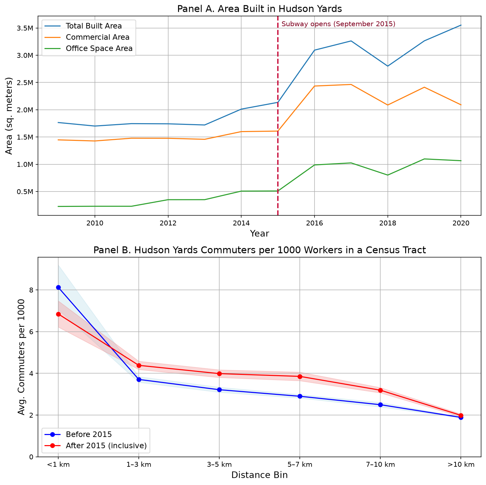
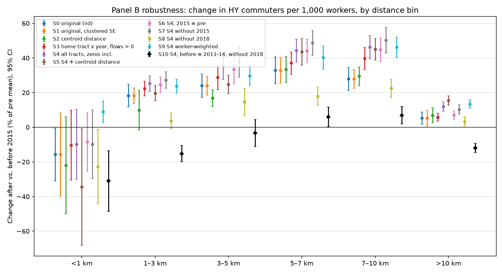
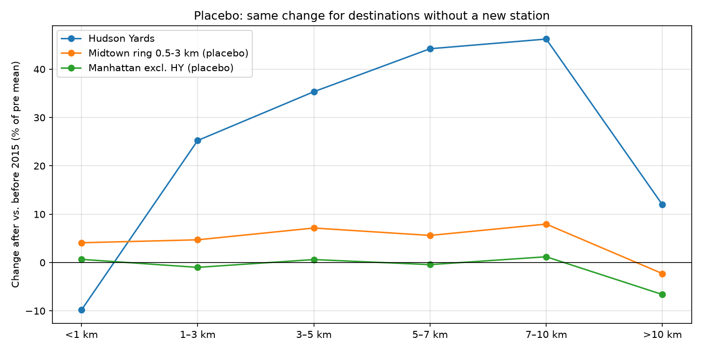
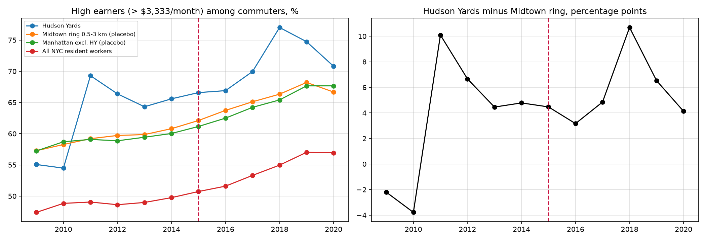
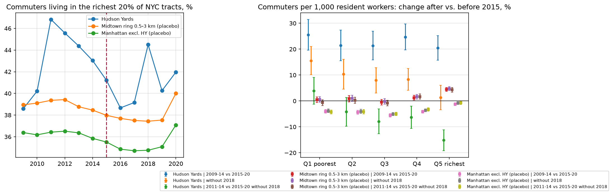

# Subway Opening in the Process of Urban Revival: Hudson Yards, New York City

**How does a new subway station change who commutes into a redeveloping neighbourhood?**


Fedor Shafranov — final assignment, Housing course, LMU Munich (July 2025).
Paper: [`Writing/main.pdf`](Writing/main.pdf) (LaTeX rebuild) · as submitted:
[`Writing/original/Fedor_Shafranov_Housing.pdf`](Writing/original/Fedor_Shafranov_Housing.pdf)

---

## The paper

**Setting.** Hudson Yards in New York City was once underdeveloped compared to other Manhattan
neighborhoods, primarily consisting of unused land and rail yards owned by the MTA. Development began in
2012, becoming one of the largest privately-led real estate projects (Fisher and Leite 2018). In September
2015, the 34th Street–Hudson Yards subway station opened. As the last case of a new station built in a
completely new neighborhood in NYC, it offers a unique case study of how commercial development interacts
with urban infrastructure. This study examines how the opening of the subway influences commuter patterns
in the area.

**Data.** To estimate changes in commuting patterns, I use two datasets: the Primary Land Use Tax Lot Output
(PLUTO) from the New York City Department of City Planning (2025) and the LEHD Origin-Destination Employment
Statistics (LODES) from the U.S. Census Bureau (2025). PLUTO contains data on all tax lots in New York City,
updated annually to reflect demolitions and new constructions. I aggregate the data to the census tract
level for the Hudson Yards area to track neighborhood development. LODES provides a cross-product of census
blocks in New York State. I aggregate this data to the tract level and identify workers commuting to Hudson
Yards from each New York census tract. I then estimate the distance between tracts.

**Fact.** I observe two key trends in the data. First, the subway opening stimulates construction. Panel A
of Figure 1 shows that after 2015, development in Hudson Yards accelerated. Second, it increases commutes for
people living farther from the area, replacing those who live nearby. Panel B shows that, for all distance
bins except the closest one, the number of commuters rose.

**Discussion.** The second fact is of main interest because it shows gentrification of the community in
action. The newly built subway increases construction in the neighborhood and attracts new commuters
because of more available transit and more opportunities.

**Literature.** The fact relates to previous literature that studies the effects of urban revival and
development of urban infrastructure. Previous literature considered how rail transit development introduced
advanced degree holders to the neighborhood (Liang et al. 2022). The other publications analyzed changes in
housing prices (Guan et al. 2024) and ridership increase (Gonzalez-Navarro and Turner 2018). My analysis is
novel because it shows quantitatively how more people living far away from the neighborhood decide to
commute because of new infrastructure and available transit. Previously, changes in commuters were not
studied over a geographic distance.



*Figure 1: Impact of Subway on Construction and Commuting Patterns. Panel A shows changes in construction in
Hudson Yards from 2009 to 2020, with the built area divided into three categories: total area, commercial
space, and office space. The areas are converted from square feet to square meters, and the vertical line
marks the subway opening. Panel B illustrates changes in commuting patterns to Hudson Yards before and after
the subway opened. The y-axis represents the average number of Hudson Yards commuters per 1,000 workers in
their census tract, while the x-axis bins census tracts based on their distance from Hudson Yards.*

## Robustness

After the course I re-estimated Panel B under eleven specifications ([`robustness/`](robustness/), full
write-up in [`robustness/README.md`](robustness/README.md)). Each point below is the change from before to
after 2015 in Hudson Yards commuters per 1,000 workers, in % of the pre-2015 mean, with 95 % confidence
intervals clustered by home tract. The specifications change the sample (all NYC tracts including those with
no Hudson Yards commuters), the distance measure (centroid instead of edge-to-edge), the unit of observation,
the weighting, and the timing (2015 as a pre-opening or transition year, without 2018, and a "before" period
of 2011–14 only).



One year stands out. In 2018 jobs in one of the three Hudson Yards tracts jump from about 4,900 to 22,800 and
fall back to 12,600 in 2019. A one-year jump of this kind most likely reflects an employer reporting its jobs
under a new address, not the station that opened three years earlier, and it inflates the "after" period in
every distance bin. The early years 2009–10 also lie well below all later years and pull the "before" period
down. Even so, the pattern holds when both are removed (S8 without 2018; S10 also without 2009–10): commuting
from tracts within 3 km of Hudson Yards falls (−15 % to −31 % in S10), while commuting from 5–10 km away
rises relative to both nearer and farther tracts. The effects are smaller than in the original figure, but
the substitution of nearby workers by workers from farther neighbourhoods remains.



The pattern is also specific to Hudson Yards. For workplaces in the rest of Manhattan, and for the Midtown
tracts 0.5–3 km from Hudson Yards that got no new station, the same before/after change is small (−7 % to +8 %) in
every distance bin. So the result is not a citywide shift towards longer commutes.

## A separate hypothesis: did richer commuters start coming?

A natural follow-up question is whether the new station brought in workers who earn more, or who live in
richer neighbourhoods. LODES splits every commuting flow by monthly earnings (up to $1,250, $1,251–3,333,
above $3,333), which allows two checks ([`robustness/income_composition.py`](robustness/income_composition.py)).



**Earnings of the commuters.** The share of high earners among Hudson Yards commuters jumped in 2011, when the
number of jobs in one of the Hudson Yards tracts tripled, years before the station. After that it stays about 3–5 percentage
points above the nearby Midtown tracts, with no change around 2015 apart from the 2018 spike. The comparison
with Midtown is needed because the earnings thresholds are not adjusted for inflation, so the share rises
everywhere over time.



**Wealth of the home neighbourhoods.** Home tracts are ranked into fifths by the share of high earners among
their residents in 2009–11. The share of Hudson Yards commuters coming from the richest fifth peaks in 2011
and then declines to the Midtown level. Around the opening, commuting from the richest tracts falls rather
than rises. This mostly repeats the distance result, because almost all tracts within 3 km of Hudson Yards
belong to the richest fifth.

**In short, nothing really happened here:** there is no sign that the subway changed the earnings or the
neighbourhood wealth of the workers coming to Hudson Yards.

## Further research

A single station opening is one observation, and it coincided with one of the largest real-estate
developments in the city, so this case alone cannot separate the subway from the development around it.
The natural next step is more data: many station openings across New York and in other cities around
the world, each with commuting flows by origin before and after. That would make it possible to test whether
this is a general fact: that new subway access leads to local resident workers being replaced by commuters
from farther-away neighbourhoods.

## Data

| Source | Years | Unit | Used for |
|---|---|---|---|
| [PLUTO](https://www.nyc.gov/site/planning/data-maps/open-data/dwn-pluto-mappluto.page), NYC Department of City Planning (archived releases 09v2 … 20v8) | 2009–2020 | tax lot → census tract | Panel A: floor area by use |
| [LODES 8](https://lehd.ces.census.gov/data/#lodes) origin–destination, NY, main file, all primary jobs (JT01), U.S. Census Bureau | 2009–2020 | census block pair → tract pair | Panel B: commuters by home tract |
| [2020 cartographic-boundary census tracts](https://www.census.gov/geographies/mapping-files/time-series/geo/cartographic-boundary.2020.html), NY, 1:500k, U.S. Census Bureau | 2020 | tract polygons | Panel B: distance to Hudson Yards |

Every cleaning and construction decision is listed in [`data/README.md`](data/README.md).
**Raw data (~2.3 GB compressed) are not included**; `master.py` downloads them into `data/raw/`
(see [`data/raw/README.md`](data/raw/README.md)).

## Reproduce

Requirements: [uv](https://docs.astral.sh/uv/) (installs Python 3.13 and the packages from `uv.lock`).

```bash
uv sync                                 # Python environment
uv run python master.py                 # download raw data, clean, build, Figure 1, robustness, paper
uv run python master.py --check         # ... and compare with the original output and the frozen baseline
```

Other options: `--list` (show steps), `--stage cleaning` / `--only panel_b` / `--from processing`
(partial runs), `--stage robustness` (robustness checks only), `--link-from DIR` (use raw files you
already have instead of downloading), `--set-baseline` (freeze current outputs). Each step writes a log to
`logs/`. A full run takes a few minutes plus download time on a laptop.

### Pipeline

| Stage | Script | Output |
|---|---|---|
| collection | `data/scripts/collection/download_raw.py` | `data/raw/{pluto,lodes,tracts}/` (checksums: `raw_manifest.csv`) |
| cleaning | `data/scripts/cleaning/clean_pluto.py` | `data/clean/pluto/pluto_agg_MN_all_years.csv` — Manhattan tract × year |
| cleaning | `data/scripts/cleaning/clean_lodes.py` | `data/clean/lodes/hudson_commuters.csv`, `total_workers.csv` |
| processing | `data/scripts/processing/build_commute_distance.py` | `data/processed/commute_distance.csv` — shares and distances |
| empirics | `empirics/scripts/01_panel_a_construction.py` | Figure 1A + `empirics/results/tables/panel_a_built_area.csv` |
| empirics | `empirics/scripts/02_panel_b_commuters.py` | Figure 1B + `empirics/results/tables/panel_b_commuters_by_distance.csv` |
| empirics | `empirics/scripts/03_figure1_combined.py` | Figure 1 (`empirics/results/figures/fig1_combined.png/.pdf`) |
| robustness | `robustness/robustness_checks.py` | `robustness/results/{tables,figures}/` |
| writing | `Writing/scripts/build_paper.py` | `Writing/main.pdf` (skipped without LaTeX) |
| check | `data/scripts/checks/check_replication.py` | compares outputs with `archive/legacy_outputs/` and `archive/baseline/` |

Paths and constants (years, tract codes, distance bins) are set once in [`config.py`](config.py).

### Replication status

The scripts are a one-to-one translation of the original Jupyter notebooks (kept in
[`archive/original_notebooks/`](archive/original_notebooks/)); no method was changed.

- **Panel A** — the cleaned PLUTO tract panel is identical, cell by cell, to the file the original
  notebook saved (3,479 tract-years; `archive/legacy_outputs/`), and the figure matches the submitted one.
- **Panel B** — the six distance-bin means for both periods reproduce the submitted figure
  (e.g. < 1 km: 8.12 before vs. 6.85 after; 1–3 km: 3.71 vs. 4.38).

All outputs are frozen in `archive/baseline/`; `master.py --check` reports any change.

## Repository structure

```
master.py, config.py          run everything / shared settings
data/raw/                     raw downloads (not in git)
data/scripts/                 collection, cleaning, processing, checks
data/clean/, data/processed/  generated data (not in git)
empirics/scripts/             figure scripts
empirics/results/             figures and the tables behind them
robustness/                   robustness checks of Panel B and their results
Writing/                      the paper (LaTeX) and the submitted PDF
archive/                      original notebooks, legacy output, frozen baseline
```

## References

- Fisher, B. and Leite, F. (2018). The Cost of New York City's Hudson Yards Redevelopment Project. Schwartz
  Center for Economic Policy Analysis and Department of Economics, The New School for Social Research,
  Working Paper Series 2018-2.
- Gonzalez-Navarro, M. and Turner, M. A. (2018). Subways and Urban Growth: Evidence from Earth. *Journal of
  Urban Economics* 108: 85–106.
- Guan, C., You, M., Li, Y., Tan, J. and Jenq, C. (2024). Analyzing Adverse Effects of Subway Extension on
  Housing Prices in Affluent Urban Neighborhoods: Evidence from the Q-Line in Manhattan. *Applied Geography* 166.
- Liang, C., Huang, Y., Yip, T. L. and Li, V. J. (2022). Does Rail Transit Development Gentrify Neighborhoods?
  Evidence from Hong Kong. *Transportation Research Part A: Policy and Practice* 155: 354–372.
  https://doi.org/10.1016/j.tra.2021.11.022
- New York City Department of City Planning (2025). Primary Land Use Tax Lot Output (PLUTO). NYC Open Data,
  https://data.cityofnewyork.us/City-Government/Primary-Land-Use-Tax-Lot-Output-PLUTO-/64uk-42ks, accessed
  31 July 2025.
- U.S. Census Bureau (2025). LEHD Origin-Destination Employment Statistics, ny_od_main_JT01_2009 to
  ny_od_main_JT01_2020. https://lehd.ces.census.gov/data/lodes, accessed 31 July 2025.

## Citation

Shafranov, F. (2025). *Subway Opening in the Process of Urban Revival.* Final assignment, Housing,
LMU Munich. Replication package, https://github.com/gomelec/hudson-yards-subway.
